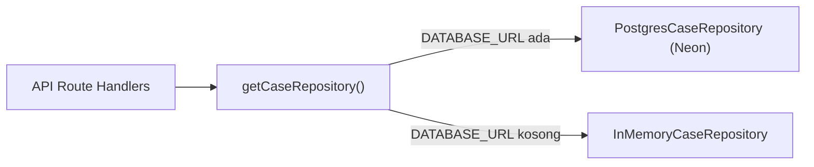

# HAKKU (V2) — Master Project Handoff Guide

> **Target Pembaca:** AI Coding Agents, Software Architects, Senior Developers  
> **Tujuan Dokumen:** Panduan transisi komprehensif untuk memahami seluruh arsitektur, modul bisnis, skema basis data, kontrak API, dan logika hukum HAKKU V2 agar dapat melanjutkan pengembangan fitur web maupun membangun ekosistem pendukung tanpa kehilangan konteks.  
> **Terakhir Diperbarui:** Oktober 2026

---

## 1. Ringkasan Eksekutif & Misi Produk

**HAKKU** (*Pahami Hakmu. Tentukan Langkahmu.*) adalah platform pendamping hukum digital (*digital legal companion*) yang dirancang untuk mengatasi kesenjangan akses keadilan (*justice gap*) di Indonesia, khususnya bagi pekerja rentan, konsumen transaksi digital, dan masyarakat awam.

### Prinsip Utama yang Tidak Boleh Dilanggar:
1. **Safety-First & Emergency Triage:** Setiap masukan pengguna yang mengandung indikasi kekerasan fisik, ancaman pidana aktif, atau KDRT harus segera dipotong jalurnya (*short-circuit*) dan diarahkan ke kontak bantuan darurat resmi (SAPPA 129, Polisi 110, YLBHI).
2. **Zero-Hallucination Legal Grounding:** HAKKU **tidak pernah** mengarang nomor undang-undang, pasal, putusan pengadilan, atau tenggat waktu fiktif. Seluruh rujukan hukum bersumber dari basis data statuter terverifikasi di [`src/modules/legal/corpus.ts`](src/modules/legal/corpus.ts).
3. **Pemisahan Entitas & Fakta (*Fact Separation*):** Fakta yang dinyatakan pengguna (`knownFacts`), informasi krusial yang belum diketahui (`unknownFacts`), dan pasal hukum dipisahkan secara tegas dalam antarmuka.
4. **Bukan Pengganti Advokat:** HAKKU adalah instrumen pra-litigasi dan pemberdayaan awal, bukan kantor hukum dan tidak menjanjikan kemenangan perkara.

---

## 2. Stack Teknologi & Standar Rekayasa

| Komponen | Teknologi | Keterangan & Pola Implementasi |
| :--- | :--- | :--- |
| **Web Framework** | **Next.js 16.4.2** | App Router, Turbopack, Partial Prerendering (PPR), Cache Components. |
| **UI Library** | **React 19.3.0** | Pola mutakhir: `useSyncExternalStore` untuk state storage & waktu client, render-time state adjustment pada navigasi, memoized callbacks (`useCallback`). Bebas cascading render. |
| **Styling** | **Tailwind CSS v4** | CSS tokens terpusat di `src/app/globals.css`, Lucide React Icons, micro-interactions confetti (`canvas-confetti`). |
| **Basis Data** | **Neon Serverless Postgres** | Pooling koneksi via `pg.Pool`, multi-branch architecture. Dilengkapi fallback otomatis ke `InMemoryCaseRepository` jika dijalankan tanpa internet atau tanpa `DATABASE_URL`. |
| **Otentikasi** | **Neon Auth** | Managed Better Auth (`@neondatabase/auth`). Endpoint integrasi di `/api/auth/[...path]`. |
| **Kecerdasan Buatan** | **Google Gemini 2.5 Flash** | Model `gemini-2.5-flash` via REST API endpoint dengan graceful fallback ke **Deterministic Rule Engine** jika API Key kosong/gagal. |
| **Generasi PDF** | **jsPDF + html2canvas** | Utilitas client-side [`src/lib/pdf.ts`](src/lib/pdf.ts) mengisolasi lembar dokumen formil menjadi berkas A4 berkualitas tinggi (skala 2x). |
| **Deteksi Perangkat** | **WebUSB & Local Sync** | Hook [`src/lib/printer.ts`](src/lib/printer.ts) mendeteksi perangkat pencetak fisik dan hanya menampilkan tombol cetak jika perangkat tersambung. |
| **Validasi Skema** | **Zod v4** | Validasi skema ketat di seluruh boundary API dengan batas payload, limit array, dan regex proteksi. |
| **Test Runner** | **Node.js Native Test** | `tsx --test tests/**/*.test.ts` (50 unit & integration tests lolos 100%). |

---

## 3. Peta Modul Inovasi Inti (Code & Domain Mapping)

```
src/
├── app/                      # Next.js App Router (Halaman & Endpoint API)
│   ├── pendampingan/         # Alur 3-Langkah: Cerita -> Klarifikasi -> Rujukan & Checklist
│   ├── konsultasi/           # Tanya Hakki (Wawancara AI Interaktif & Asesmen Real-Time)
│   ├── dokumen/              # Generator Draf Surat Formil Siap Pakai
│   ├── kalkulator/           # Kalkulator Kompensasi Ketenagakerjaan PP 35/2021
│   ├── bukti/                # Audit Matriks Bukti & Generator Laporan Pengaduan
│   ├── kasus/[code]/         # Detail Kasus & Statutory Countdown Tracker (14 Hari)
│   ├── akun/                 # Portal Riwayat & Berkas Perkara Pengguna
│   └── api/                  # REST Handlers (intake, consultation, documents, calculator, evidence, cases)
├── components/               # Komponen UI Modular
│   ├── case/                 # StatutoryCountdownTracker.tsx
│   ├── consultation/         # ConsultationChatInterface, AssessmentCard, QuickPrompts
│   ├── document/             # LegalDocumentGenerator.tsx
│   ├── evidence/             # EvidenceAuditWorkspace.tsx
│   ├── mascot/               # MascotHakki.tsx (4 Mood: welcoming, listening, thinking, advising)
│   ├── flow/                 # StoryInputStep, ClarificationStep, ChecklistAndReferralsStep
│   └── layout/               # Header, Footer, Breadcrumbs
├── lib/                      # Utilitas Bersama
│   ├── formatters.ts         # formatRupiah, formatIndonesianDate, formatShortDate, generateCaseCode
│   ├── pdf.ts                # downloadElementAsPdf (html2canvas + jsPDF)
│   ├── printer.ts            # usePrinterStatus (WebUSB & useSyncExternalStore)
│   ├── confetti.ts           # Efek selebrasi aksi hukum
│   └── utils.ts              # ClassNames merger (clsx + tailwind-merge)
└── modules/                  # Domain Business Logic Terisolasi
    ├── ai/                   # AI Provider Interface (Gemini & Mock Provider Factory)
    ├── calculator/           # Aturan Kompensasi Statuter PP 35/2021 (Pasal 15, 17, 40-52)
    ├── consultation/         # Ekstraktor ranah perkara, pasal hukum, dan prompt cerdas
    ├── db/                   # Neon Postgres Pool, Schema Migrations, Repository Pattern
    ├── document/             # Generator naskah surat (Bipartit, Somasi, LBH)
    ├── evidence/             # Evaluator alat bukti KUHAP 184 & scoring kesiapan berkas
    ├── intake/               # Safety triage, redaksi kejahatan, dan pemisah fakta
    └── legal/                # Korpus peraturan perundang-undangan RI terverifikasi
```

### Rincian 6 Modul Inovasi:
1. **Intake & Triase Keselamatan ([`src/modules/intake/`](src/modules/intake/)):**
   - Mendeteksi kategori sengketa (`labor`, `digital_scam`, `tenancy_contract`, `consumer_dispute`, `general_civil`, `other`).
   - Menganalisis urgensi (`low`, `normal`, `urgent`, `critical`).
   - Memisahkan fakta pengguna vs celah informasi (`knownFacts` & `unknownFacts`).
2. **Wawancara AI & Asesmen Real-Time ([`src/modules/consultation/`](src/modules/consultation/)):**
   - Mendampingi pengguna seperti advokat pra-konsultasi.
   - Menghasilkan kartu asesmen dinamis: potensi pasal pelanggaran, estimasi nilai hak finansial, serta chip tindakan cepat (*smart prompts*).
3. **Generator Draf Surat Formil ([`src/modules/document/`](src/modules/document/)):**
   - Menghasilkan draf siap tanda tangan untuk:
     - **Permohonan Perundingan Bipartit** (Pasal 3 ayat 1 UU 2/2004).
     - **Surat Somasi / Teguran Hukum Tertulis** (Pasal 1238 KUHPerdata).
     - **Lembar Fakta & Permohonan Bantuan Hukum LBH** (UU 16/2011).
4. **Kalkulator Kompensasi Ketenagakerjaan Statuter ([`src/modules/calculator/`](src/modules/calculator/)):**
   - Menghitung hak finansial secara deterministik matematis sesuai **PP No. 35 Tahun 2021**:
     - Uang Pesangon (UP) Pasal 40 ayat 2.
     - Uang Penghargaan Masa Kerja (UPMK) Pasal 40 ayat 3.
     - Uang Penggantian Hak (UPH) Pasal 40 ayat 4.
     - Kompensasi PKWT Pasal 15: `(Masa Kerja Bulan / 12) * Upah Bulanan`.
     - Ganti Rugi Sisa Kontrak PKWT Pasal 17.
     - Pengali alasan PHK Pasal 43–52 (efisiensi rugi 0.5x, pensiun 1.75x, meninggal 2x, resign 0x).
5. **Audit Matriks Bukti & Laporan Pengaduan ([`src/modules/evidence/`](src/modules/evidence/)):**
   - Mengelompokkan bukti menurut Pasal 184 KUHAP & UU ITE 1/2024.
   - Memberikan skor kesiapan berkas (0–100%) dan rekomendasi penambalan bukti.
   - Menghasilkan naskah formal laporan pengaduan dengan kodefikasi bukti (`[P-1]`, `[P-2]`, dst.).
6. **Statutory Response Countdown Tracker ([`src/components/case/StatutoryCountdownTracker.tsx`](src/components/case/StatutoryCountdownTracker.tsx)):**
   - Menghitung mundur masa tunggu tanggapan hukum: **14 hari kerja** untuk bipartit (UU 2/2004) dan **7–14 hari kalender** untuk somasi perdata (KUHPerdata 1238).
   - Membuka panduan eskalasi resmi (Disnaker/Pengadilan) saat batas waktu berakhir tanpa tanggapan.

---

## 4. Skema Basis Data & Pola Akses Data (Repository Pattern)

HAKKU menggunakan arsitektur abstraksi repository terisolasi di [`src/modules/db/repository.ts`](src/modules/db/repository.ts):



### Tabel Utama:
1. **`cases`**:
   - `id UUID PRIMARY KEY`: Identitas internal.
   - `case_code VARCHAR(32) UNIQUE`: Kode kasus publik aman, format `HK-YYYY-XXXX` (menggunakan `crypto.randomBytes(2)`).
   - `user_id VARCHAR(128)`: ID pengguna Neon Auth (opsional untuk guest).
   - `title`, `category`, `category_label`, `urgency_level`: Klasifikasi perkara.
   - `original_story TEXT`: Cerita mentah pengguna.
   - `structured_facts JSONB`: Menyimpan `knownFacts` dan `unknownFacts`.
   - `analysis JSONB`: Kualifikasi hukum, estimasi nominal, dan pasal rujukan.
   - `status VARCHAR(32)`: `active`, `in_progress`, `resolved`, `archived`.
2. **`checklist_items`**:
   - `id UUID PRIMARY KEY`, `case_code_id UUID REFERENCES cases(id) ON DELETE CASCADE`.
   - `item_id VARCHAR(64)`, `title VARCHAR(255)`, `description TEXT`.
   - `completed BOOLEAN`, `completed_at TIMESTAMPTZ`.

---

## 5. Referensi Kontrak REST API

Seluruh endpoint menerima dan mengembalikan data berformat JSON:

| Endpoint | Method | Input Penting (Zod) | Output Utama |
| :--- | :--- | :--- | :--- |
| `/api/intake/analyze` | `POST` | `{ story: string (10..10000 chars) }` | `{ success, data: CaseFactSummary }` |
| `/api/consultation/chat` | `POST` | `{ messages: Array<{role, content}>, mode: "general"|"deep" }` | `{ reply, assessment: ConsultationAssessment }` |
| `/api/documents/generate` | `POST` | `{ templateType, factSummary, customFields }` | `{ document: GeneratedLegalDocument }` |
| `/api/calculator` | `POST` | `{ contractType, monthlySalary, startDate, endDate, terminationReason }` | `{ breakdown: CompensationBreakdown }` |
| `/api/evidence/audit` | `POST` | `{ caseTitle, reporter, reportedParty, evidences, events }` | `{ evaluation: EvidenceAuditEvaluation }` |
| `/api/cases` | `GET` | Query param: `?userId=...` | `{ cases: CaseRecord[] }` |
| `/api/cases` | `POST` | `{ title, category, categoryLabel, urgencyLevel, originalStory, structuredFacts, analysis }` | `{ caseCode: "HK-YYYY-XXXX", caseRecord }` |
| `/api/cases/[idOrCode]` | `GET` | Param: `^[a-zA-Z0-9_-]{1,64}$` | `{ case: CaseRecord, checklist: ChecklistItemRecord[] }` |
| `/api/cases/[idOrCode]` | `DELETE`| Param: `^[a-zA-Z0-9_-]{1,64}$` | `{ success: true, message: "Perkara berhasil dihapus secara permanen" }` |
| `/api/cases/[idOrCode]/checklist` | `PATCH` | `{ itemId: string, completed: boolean }` | `{ success: true, updatedItem }` |

---

## 6. Utilitas Terpusat & Anti-Duplikasi

Jangan membuat fungsi format mata uang atau tanggal baru. Gunakan [`src/lib/formatters.ts`](src/lib/formatters.ts):
- `formatRupiah(amount: number): string` ➔ Contoh: `Rp 5.500.000`
- `formatIndonesianDate(date: string | Date): string` ➔ Contoh: `21 Oktober 2026`
- `formatShortDate(date: string | Date): string` ➔ Contoh: `21 Okt 2026`
- `generateCaseCode(): string` ➔ Contoh: `HK-2026-F4B2` (kriptografis acak)

---

## 7. Kebijakan Copywriting UI (Aturan Bebas Jargon)

> ⚠️ **Aturan Penting:** Jangan menyebut kata **"database"** atau nama mesin basis data internal (*Postgres*, *SQL*, dll.) pada teks antarmuka pengguna web.  
> Gunakan istilah yang ramah masyarakat:
> - `"Menyimpan ke Database"` ➔ `"Menyimpan Perkara"`
> - `"Tersimpan di Database"` ➔ `"Tersimpan dengan Aman"`
> - `"Server database"` ➔ `"Server penyimpanan"`

---

## 8. Verifikasi Kualitas & Perintah Eksekusi

```bash
# 1. Jalankan linter ESLint (wajib 0 errors, 0 warnings)
npm run lint

# 2. Jalankan typechecker TypeScript (wajib 0 errors)
npm run typecheck

# 3. Jalankan unit & integration test suite (50 tests)
npm test

# 4. Jalankan pengujian integrasi database Neon
npm run test:e2e

# 5. Kompilasi production build Next.js (20/20 routes static/PPR)
npm run build
```

---

## 9. Ekosistem Mobile App (Flutter & Dart)

Bagi pengembang atau agen AI yang ditugaskan membangun versi aplikasi mobile dari HAKKU, seluruh spesifikasi arsitektur, pemilihan dependensi `pubspec.yaml`, struktur direktori `lib/`, porting logika hukum ke Dart (`StatutoryCalculatorEngine`, `StatutoryEvidenceEvaluator`, `HakkuFormatters`), integrasi fitur native (Kamera, Notifikasi Masa Tunggu 14 Hari, Biometrik, Cetak PDF Nirkabel), dan panduan roadmap implementasi telah didokumentasikan secara lengkap di:

👉 **[`mobile.md`](mobile.md)** — *HAKKU Mobile App: Panduan Arsitektur & Implementasi Flutter untuk AI Coding Agent*

- **Framework:** **Flutter (v3.24+)** dengan **Dart (v3.5+)**
- **State Management:** `flutter_riverpod` + `go_router`
- **Pola Arsitektur:** Feature-First Clean Architecture
- **Sifat Aplikasi:** Offline-First (penyimpanan lokal Isar/Hive) dengan sinkronisasi ke REST API HAKKU Web.

