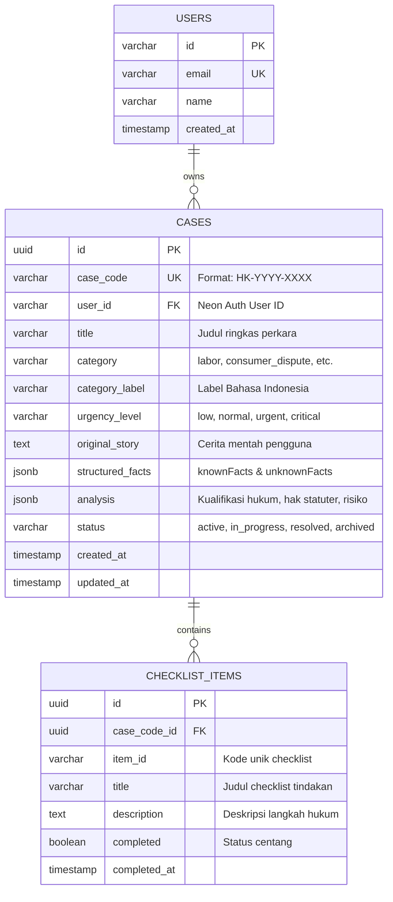

# HAKKU System Architecture & Technical Specifications

> **Versi Dokumentasi:** 2.0.0 (Production & Traspac Competition 2027)  
> **Target Audiens:** AI Coding Agents, Software Engineers, Security Auditors, Legal Tech Researchers  
> **Terakhir Diperbarui:** Oktober 2026

---

## 1. Ikhtisar Sistem & Visi Arsitektur

**HAKKU** (*Pahami Hakmu. Tentukan Langkahmu.*) adalah platform pendamping hukum digital (*digital legal companion*) berbasis AI dan basis hukum terverifikasi yang dirancang untuk mengatasi kesenjangan akses keadilan (*justice gap*) di Indonesia.

Banyak masyarakat ragu atau takut mencari keadilan karena:
1. Ketidaktahuan hukum & terminologi rumit (*legalese*).
2. Biaya konsultasi hukum awal yang mahal.
3. Ketiadaan struktur kronologi dan alat bukti yang siap uji di depan instansi atau advokat.
4. Risiko halusinasi AI generik yang mengarang pasal, nomor putusan, atau tanggal kedaluwarsa.

HAKKU dibangun dengan arsitektur **Modular Monolith** berprinsip *Safety-First, Zero-Hallucination, and Statutory-Grounded*. Seluruh inferensi AI dibatasi oleh skema formal (*Zod*), dipadukan dengan mesin kalkulasi deterministik (*rule engines*), dan diverifikasi terhadap peraturan perundang-undangan Republik Indonesia yang sah.

```mermaid
graph TB
    subgraph ClientLayer ["Client Layer (Next.js 16 + React 19)"]
        UI_Home["Beranda & Quick Intake"]
        UI_Chat["Wawancara AI (/konsultasi)"]
        UI_Doc["Draf Dokumen Formil (/dokumen)"]
        UI_Calc["Kalkulator Kompensasi (/kalkulator)"]
        UI_Evidence["Audit Matriks Bukti (/bukti)"]
        UI_Tracker["Statutory Countdown (/kasus/[code])"]
        UI_Account["Manajemen Kasus (/akun)"]
    end

    subgraph APILayer ["API Routing & Security Layer (Next.js App Router)"]
        API_Intake["POST /api/intake/analyze"]
        API_Chat["POST /api/consultation/chat"]
        API_Doc["POST /api/documents/generate"]
        API_Calc["POST /api/calculator"]
        API_Evidence["POST /api/evidence/audit"]
        API_Cases["GET/POST /api/cases"]
        API_CaseDetail["GET/DELETE /api/cases/[idOrCode]"]
        API_Checklist["PATCH /api/cases/[idOrCode]/checklist"]
        API_Auth["ALL /api/auth/[...path]"]
    end

    subgraph CoreEngine ["Domain Modules & Engine"]
        Safety_Triage["Safety & Emergency Triage"]
        Corpus_Engine["Verified Indonesian Legal Corpus"]
        Fact_Separator["Fact Separation & Structuring"]
        Calc_Engine["PP 35/2021 Compensation Engine"]
        Doc_Engine["Formal Legal Document Formatter"]
        Evidence_Engine["KUHAP 184 Evidence Evaluator"]
        AI_Provider["AI Provider Interface (Gemini 2.5 / Mock Rule-Based)"]
    end

    subgraph DataLayer ["Data & Storage Layer"]
        Neon_Auth["Neon Auth (Managed Better Auth)"]
        Neon_DB[("Neon Serverless Postgres\n(Multi-Branch Architecture)")]
        Memory_Repo[("In-Memory Fallback Repository")]
    end

    UI_Home --> API_Intake
    UI_Chat --> API_Chat
    UI_Doc --> API_Doc
    UI_Calc --> API_Calc
    UI_Evidence --> API_Evidence
    UI_Tracker --> API_Checklist
    UI_Account --> API_Cases

    API_Intake --> Safety_Triage
    API_Intake --> Fact_Separator
    API_Intake --> AI_Provider

    API_Chat --> AI_Provider
    API_Chat --> Corpus_Engine

    API_Doc --> Doc_Engine
    API_Doc --> Corpus_Engine

    API_Calc --> Calc_Engine
    API_Calc --> Corpus_Engine

    API_Evidence --> Evidence_Engine
    API_Evidence --> Corpus_Engine

    API_Cases --> Neon_DB
    API_Cases -.-> Memory_Repo
    API_CaseDetail --> Neon_DB
    API_Checklist --> Neon_DB
    API_Auth --> Neon_Auth
```



---

## 2. Rincian 6 Modul Inovasi Utama

### Modul 1: Intake & Triase Keselamatan (*Safety Triage*)
- **Lokasi Direktori:** [`src/modules/intake/`](file:///home/rasshqa/projects/HAKKU-V2/src/modules/intake/)
- **Tujuan:** Menerima keluhan pengguna dalam bahasa sehari-hari tanpa istilah hukum teknis, memfilter konten berbahaya/ilegal, dan mengidentifikasi potensi darurat.
- **Mekanisme Triase:**
  1. *Safety Filter:* Jika input terdeteksi memuat kekerasan fisik aktif, KDRT, ancaman pembunuhan, atau pemerasan, sistem langsung menetapkan status `urgencyLevel: "critical"` dan menyajikan nomor darurat resmi (SAPPA 129, Polisi 110, YLBHI).
  2. *Illegal Request Guard:* Jika pengguna meminta bantuan untuk meretas (*hacking*), memalsukan dokumen, atau mencuci uang, sistem menolak dan memberikan peringatan etis hukum.
  3. *Fact Separation Protocol:* Memisahkan secara kaku antara:
     - `knownFacts`: Fakta yang secara eksplisit dinyatakan oleh pengguna.
     - `unknownFacts`: Informasi krusial yang belum diketahui (misal: apakah ada kontrak tertulis, bukti transfer, dsb.).
     - `clarifications`: Pertanyaan pemandu untuk melengkapi celah fakta.

### Modul 2: Wawancara Tanya AI & Asesmen Real-Time
- **Lokasi Direktori:** [`src/modules/consultation/`](file:///home/rasshqa/projects/HAKKU-V2/src/modules/consultation/)
- **Tujuan:** Sesi interaktif dinamis mendampingi pengguna menggali duduk perkara layaknya wawancara pra-konsultasi advokat.
- **Komponen Kunci:**
  - `ConsultationAssessment`: Secara otomatis mendeteksi kategori hukum, dasar pasal peraturan perundang-undangan, estimasi nominal hak atau kerugian, kelengkapan berkas, serta daftar tindakan cepat (*smart prompts* dan *recommended actions*).
  - Integrasi Maskot Hakki: Menyajikan respon ekspresif (*welcoming*, *listening*, *thinking*, *advising*) untuk meredakan ketegangan psikologis pengguna.

### Modul 3: Generator Draf Surat Formil Siap Pakai
- **Lokasi Direktori:** [`src/modules/document/`](file:///home/rasshqa/projects/HAKKU-V2/src/modules/document/)
- **Tujuan:** Menghasilkan dokumen hukum formal berkekuatan hukum yang siap dicetak atau disimpan.
- **Format Templat Tersedia:**
  1. **Permohonan Perundingan Bipartit:** Sesuai mandat UU No. 2 Tahun 2004 (PPHI) Pasal 3 ayat 1, lengkap dengan ruang tanggal pertemuan, dasar perselisihan hak/PHK, dan klausul iktikad baik.
  2. **Surat Somasi / Peringatan Hukum Perdata:** Sesuai Pasal 1238 KUHPerdata, memuat penetapan batas waktu tegas (7 s.d. 14 hari kalender) untuk memenuhi prestasi sebelum gugatan diajukan.
  3. **Lembar Kronologi Fakta Bantuan Hukum:** Standar ringkasan perkara untuk diserahkan ke Pos Bantuan Hukum (Posbankum) pengadilan atau kantor LBH/Advokat.

### Modul 4: Kalkulator Kompensasi Ketenagakerjaan Statuter
- **Lokasi Direktori:** [`src/modules/calculator/`](file:///home/rasshqa/projects/HAKKU-V2/src/modules/calculator/)
- **Tujuan:** Menghitung hak finansial pekerja yang terkena PHK atau berakhirnya masa kontrak secara akurat berdasarkan regulasi resmi.
- **Rujukan Hukum Deterministik:**
  - **PP No. 35 Tahun 2021 Pasal 40 ayat 2:** Tabel Uang Pesangon (UP) kelipatan upah bulanan (1 hingga 9 bulan upah sesuai rentang masa kerja).
  - **PP No. 35 Tahun 2021 Pasal 40 ayat 3:** Tabel Uang Penghargaan Masa Kerja (UPMK) kelipatan upah bulanan (2 hingga 10 bulan upah untuk masa kerja 3 hingga 24 tahun+).
  - **PP No. 35 Tahun 2021 Pasal 40 ayat 4:** Uang Penggantian Hak (UPH) termasuk cuti tahunan belum gugur dan ongkos pulang.
  - **PP No. 35 Tahun 2021 Pasal 15:** Kompensasi Pekerja Kontrak (PKWT) dengan rumus eksak: `(Masa Kerja Bulan / 12) * Upah Bulanan`.
  - **PP No. 35 Tahun 2021 Pasal 17:** Ganti rugi pemutusan PKWT sepihak oleh pengusaha (sisa bulan upah kontrak + uang kompensasi).
  - **PP No. 35 Tahun 2021 Pasal 43 s.d. Pasal 52:** Multiplier skenario khusus (efisiensi rugi 0.5x, efisiensi laba 1.0x, pailit 0.5x, pensiun 1.75x, meninggal dunia 2.0x, resign sukarela 0x UP/UPMK).

### Modul 5: Audit Matriks Bukti & Laporan Pengaduan
- **Lokasi Direktori:** [`src/modules/evidence/`](file:///home/rasshqa/projects/HAKKU-V2/src/modules/evidence/)
- **Tujuan:** Menyusun daftar inventaris alat bukti sesuai hukum acara pembuktian Indonesia dan menguji kesiapan berkas (*evidentiary readiness*).
- **Klasifikasi Alat Bukti (Pasal 184 KUHAP & HIR/RBg):**
  - Surat / Dokumen Tertulis (Kontrak kerja, slip gaji, surat sewa, mutasi rekening).
  - Bukti Elektronik / Informasi Digital (Tangkapan layar WhatsApp, email resmi, rekaman log).
  - Keterangan Saksi (Rekan kerja, tetangga kos, pihak ketiga netral).
  - Keterangan Korban / Pelapor.
  - Kuitansi / Bukti Pembayaran Finansial.
- **Fitur Kesiapan Berkas:**
  - Skor kekuatan berkas (0 - 100) dan status (`siap_diajukan`, `perlu_pelengkap`, `bukti_kritis_hilang`).
  - Rekomendasi mitigasi spesifik untuk bukti yang hilang atau belum sah.
  - Generator naskah formal laporan pengaduan dengan kodefikasi bukti (P-1, P-2, P-3...).

### Modul 6: Statutory Response Countdown Tracker
- **Lokasi Direktori:** [`src/components/case/StatutoryCountdownTracker.tsx`](file:///home/rasshqa/projects/HAKKU-V2/src/components/case/StatutoryCountdownTracker.tsx)
- **Tujuan:** Memandu pengguna mengawal masa tunggu hukum pasca pengiriman surat peringatan atau permohonan bipartit.
- **Ketentuan Waktu Hukum:**
  - Batas waktu perundingan bipartit: **Maksimal 30 hari kerja** (Pasal 3 ayat 2 UU 2/2004), dengan tahap tanggapan awal **14 hari kerja**.
  - Batas waktu somasi perdata: Standar kelaziman hukum **7 s.d. 14 hari kalender** (Pasal 1238 KUHPerdata).
  - Otomatis membuka tindakan eskalasi (*Unlocking Next Legal Action*): Jika batas waktu habis tanpa tanggapan, sistem membuka panduan permohonan mediasi ke Suku Dinas Tenaga Kerja (Disnaker) atau pelaporan gugatan wanprestasi/PMH.

---

## 3. Database Schema & Multi-Branch Architecture

HAKKU menggunakan **Neon Serverless Postgres** dengan arsitektur multi-cabang (*branching*).



### Script Migrasi & Eksekusi DDL
- Skrip migrasi terpusat: [`src/modules/db/migrate.ts`](file:///home/rasshqa/projects/HAKKU-V2/src/modules/db/migrate.ts)
- Eksekusi otomatis DDL menggunakan `CREATE TABLE IF NOT EXISTS` dan `CREATE INDEX IF NOT EXISTS` sehingga idempotent dan aman dijalankan berulang pada branch baru.
- Repository Pattern: [`src/modules/db/repository.ts`](file:///home/rasshqa/projects/HAKKU-V2/src/modules/db/repository.ts)
  - `PostgresCaseRepository`: Menggunakan koneksi pooling Neon (`pg.Pool`).
  - `InMemoryCaseRepository`: Otomatis aktif saat `DATABASE_URL` belum dikonfigurasi, memastikan aplikasi tetap 100% berfungsi saat testing atau lingkungan offline.

---

## 4. Keamanan, Validasi, & Model Ancaman (Threat Model)

HAKKU menerapkan strategi *Defense in Depth* berlapis:

| Lapisan Keamanan | Implementasi | Ancaman yang Dicegah |
| :--- | :--- | :--- |
| **HTTP Security Headers** | `next.config.ts`: `nosniff`, `SAMEORIGIN`, `XSS-Protection`, `Referrer-Policy: strict-origin-when-cross-origin`, `Permissions-Policy`. | Clickjacking, MIME-type sniffing, unauthorized cross-origin framing. |
| **Strict Schema Validation** | Zod v4 schemas pada setiap handler `/api/*` dengan batas string, limit array, dan validasi enum. | Buffer overflow, prototype pollution, JSON injection, DoS lewat payload raksasa. |
| **LLM Context Caps** | Trimming context chat menjadi maksimum 20 pesan terakhir dan pembatasan panjang prompt per pesan (maks 5.000 karakter). | Token exhaustion DoS, context injection, ballooning AI costs. |
| **Deterministic Rule Guard** | Nilai nominal kalkulator divalidasi dengan batas wajar (`max: 10_000_000_000` IDR per bulan). Rumus kompensasi dihitung secara matematis di server, bukan via LLM. | Halusinasi angka pesangon, manipulasi nominal klaim. |
| **Case Code Enumeration Defense** | Format kode kasus `HK-YYYY-XXXX` menggunakan `crypto.randomBytes(2)` yang menghasilkan karakter alfanumerik acak non-sekuensial. Parameter `idOrCode` divalidasi dengan regex ketat `^[a-zA-Z0-9_-]{1,64}$`. | Insecure Direct Object References (IDOR), URL parameter scanning. |
| **Kepatuhan Privasi (UU PDP No. 27/2022)** | Endpoint `DELETE /api/cases/[idOrCode]` mengimplementasikan hak penghapusan data secara permanen (*Right to Erasure*). Tidak ada PII atau data kasus yang dicatat ke terminal logs produksi. | Pelanggaran kerahasiaan data pribadi hukum. |

---

## 5. Standar State Management React 19

Aplikasi menggunakan React 19 dengan pola mutakhir tanpa menimbulkan cascading re-render atau SSR hydration mismatch:

1. **`useSyncExternalStore` untuk Sinkronisasi Client State:**
   - Digunakan pada [`StatutoryCountdownTracker`](file:///home/rasshqa/projects/HAKKU-V2/src/components/case/StatutoryCountdownTracker.tsx) untuk membaca jam client (`Date.now()`) dan state `localStorage`.
   - Menjamin bahwa SSR snapshot konsisten dengan HTML awal, lalu mengikat event storage lintas tab secara otomatis tanpa `useEffect(() => { setState() })`.
2. **Render-Time State Adjustment:**
   - Digunakan pada komponen navigasi [`Header`](file:///home/rasshqa/projects/HAKKU-V2/src/components/layout/Header.tsx) untuk menutup mobile menu saat rute berpindah (`if (pathname !== prevPathname)`).
3. **Memoized Handlers:**
   - Seluruh fungsi interaksi keyboard dan download file teks di-wrap dalam `useCallback` untuk mencegah re-registrasi listener yang berlebihan.

---

## 6. Panduan untuk AI Coding Agents & Developer Baru

Jika Anda adalah agen AI atau developer yang ditugaskan memodifikasi repositori ini:

1. **Aturan Utama:**
   - Jangan menambahkan styling Tailwind tanpa memeriksa tema yang terdaftar di [`src/app/globals.css`](file:///home/rasshqa/projects/HAKKU-V2/src/app/globals.css).
   - Jangan pernah melakukan *hardcode* peraturan atau pasal fiktif. Selalu rujuk ke [`src/modules/legal/corpus.ts`](file:///home/rasshqa/projects/HAKKU-V2/src/modules/legal/corpus.ts).
   - Seluruh fungsi kalkulasi uang atau tanggal wajib menggunakan [`src/lib/formatters.ts`](file:///home/rasshqa/projects/HAKKU-V2/src/lib/formatters.ts).
2. **Cara Menambahkan Templat Dokumen Baru:**
   - Definisikan tipe template pada [`src/modules/document/types.ts`](file:///home/rasshqa/projects/HAKKU-V2/src/modules/document/types.ts).
   - Daftarkan metadata dan fungsi penyusun draf pada [`src/modules/document/generator.ts`](file:///home/rasshqa/projects/HAKKU-V2/src/modules/document/generator.ts).
   - Tulis unit test terkait pada [`tests/document.test.ts`](file:///home/rasshqa/projects/HAKKU-V2/tests/document.test.ts).
3. **Cara Menjalankan Verifikasi:**
   ```bash
   # 1. Jalankan linter (harus 0 errors, 0 warnings)
   npm run lint

   # 2. Jalankan typechecker (harus 0 errors)
   npm run typecheck

   # 3. Jalankan suite pengujian unit & integrasi
   npm test

   # 4. Jalankan kompilasi Next.js production build
   npm run build
   ```
